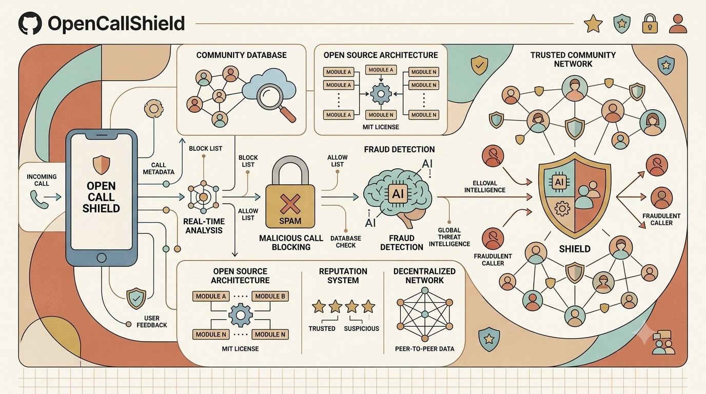
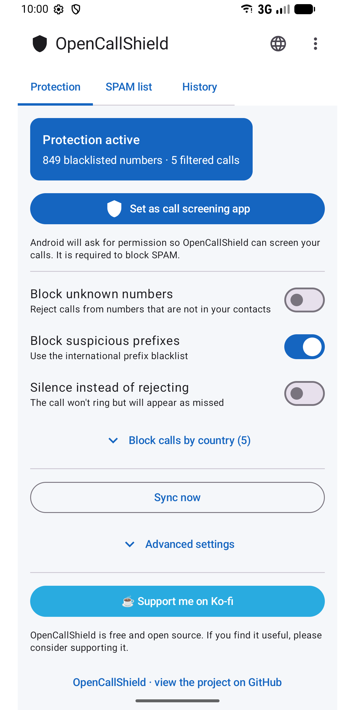
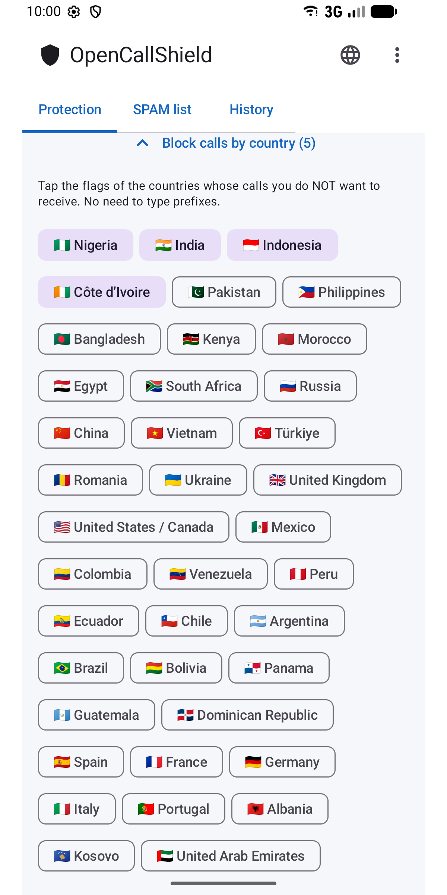
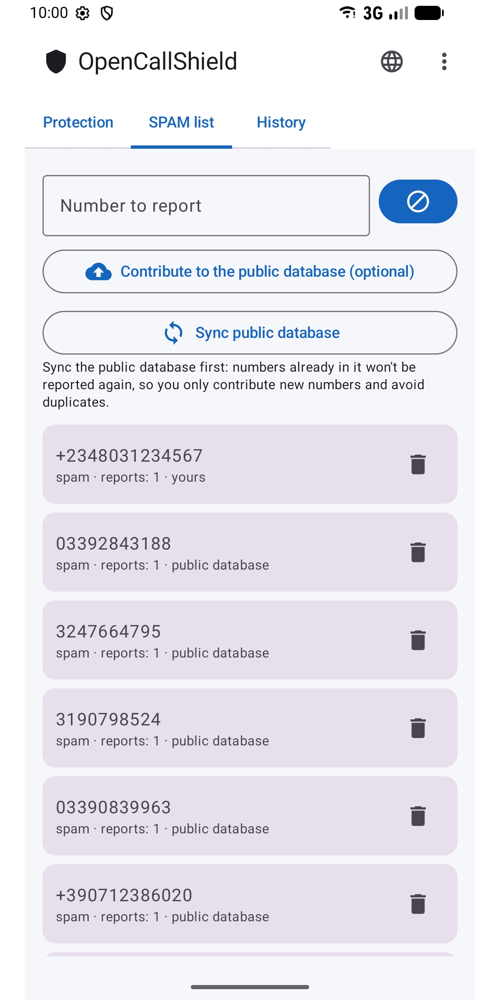
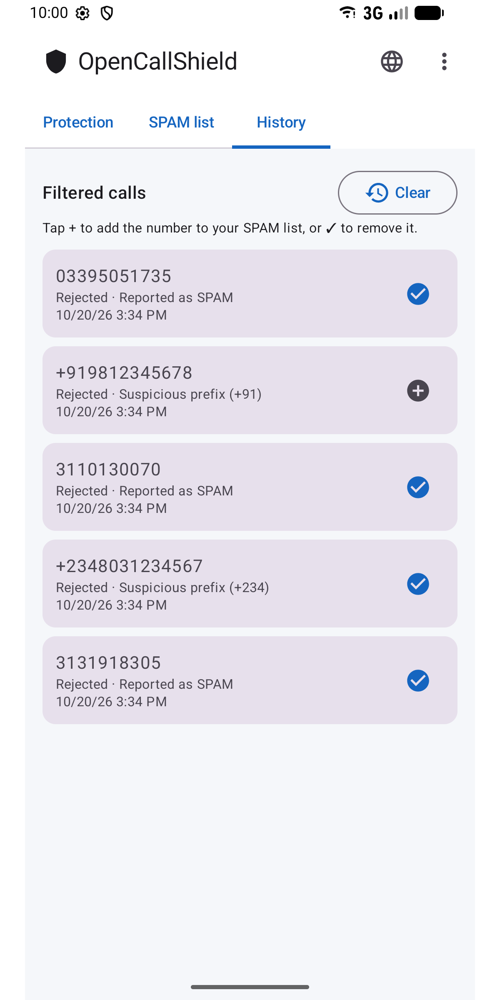
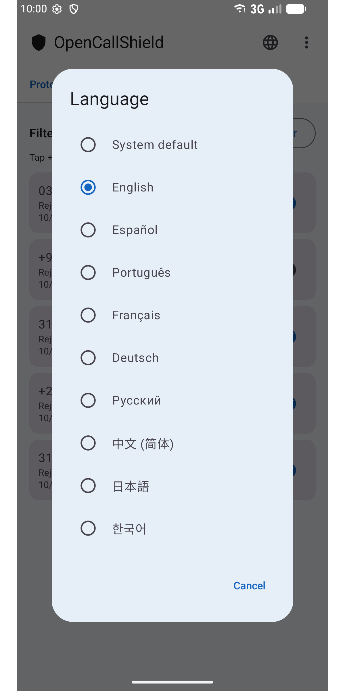

#  OpenCallShield

**English** · [Español](docs/i18n/README.es.md) · [Português](docs/i18n/README.pt.md) · [Français](docs/i18n/README.fr.md) · [Deutsch](docs/i18n/README.de.md) · [Русский](docs/i18n/README.ru.md) · [中文](docs/i18n/README.zh.md) · [日本語](docs/i18n/README.ja.md) · [한국어](docs/i18n/README.ko.md)

[](LICENSE)

<div align="center">
  
</div>

Open source (MIT) Android app that **blocks SPAM calls** using `CallScreeningService`
(Android 10+), with a local Room database, a detection rules engine and sync with a
public collaborative list hosted on GitHub.

A privacy-first, decentralized alternative to Truecaller.

## ⬇️ Download

<a href="https://play.google.com/store/apps/details?id=com.jhonsu01.opencallshield"></a>

- **Google Play:** https://play.google.com/store/apps/details?id=com.jhonsu01.opencallshield
- **Direct APK:** download the `.apk` from [**Releases**](https://github.com/jhonsu01/OpenCallShield/releases).

## 📱 Screenshots

<p>
  
  
  
  
  
</p>

Screenshots in every language are in [`playstore/screenshots/`](playstore/screenshots).

## ✨ Features

- **Automatic blocking** through `CallScreeningService` (reject or silence).
- **Rules engine:** known contact → allow; reported number → block;
  blacklisted prefix → block; number not in contacts → optional.
- **Block by country** with one tap on the flag (no prefixes to type).
- **Local Room database** of reported numbers.
- **Sync** with a public JSON on GitHub (daily via WorkManager + manual).
- **Reports** and history of filtered calls (add / remove numbers with one tap).
- **9 languages:** English, Español, Português, Français, Deutsch, Русский, 中文, 日本語, 한국어 —
  pick one from the 🌐 icon in the app or from Android's per-app language settings.
- **UI** in Jetpack Compose (Material 3).

## 🏗️ Stack

Kotlin · Jetpack Compose (Material 3) · Room · WorkManager · AppCompat (per-app language) · MVVM · `CallScreeningService` · targetSdk 36 (Android 16)

## 📦 Build

```bash
# Requires JDK 17 and the Android SDK (compileSdk 36)
./gradlew assembleDebug      # installable debug APK
./gradlew assembleRelease    # release APK (needs signing)
./gradlew bundleRelease      # AAB for Google Play
```

Outputs are in `app/build/outputs/`.

## 📲 Usage

1. Install the app.
2. Grant the contacts permission (so your contacts are never blocked).
3. Tap **"Set as call screening app"** and accept the role in Android.
4. Adjust the rules, pick countries to block and/or sync the collaborative list.

## 🌐 Collaborative list

The app syncs from [`spam_numbers.json`](spam_numbers.json) in this repository:

```
https://raw.githubusercontent.com/jhonsu01/OpenCallShield/main/spam_numbers.json
```

Format:

```json
{
  "version": "1.0",
  "updated_at": "2026-01-01",
  "numbers": [
    { "number": "+1234567890", "reports": 120, "tag": "scam" }
  ]
}
```

The URL can be changed from the app (Advanced settings), so anyone can run their own list
([guide, in Spanish](docs/CREAR_BASE_COLABORATIVA.md)).

## 🔑 Contributing from the app (optional GitHub sign-in)

From **⋮ → Collaborate** you can sign in with GitHub and then, in **SPAM list**, tap
**"Contribute to the public database"**: the app opens an **Issue** in this repo with your
reported numbers as JSON, ready to merge into `spam_numbers.json`. Signing in is optional:
the app works fully without it.

Two ways to sign in (no server/backend):

### Option A — OAuth Device Flow (recommended)

1. On GitHub: **Settings → Developer settings → OAuth Apps → New OAuth App**, then
   enable **Device Flow**.
2. Copy the **Client ID** (it is public, not a secret).
3. In the app → **Collaborate** → paste the Client ID, tap **Connect** and enter the code
   at `github.com/login/device`.

### Option B — Personal access token (PAT)

1. GitHub → **Settings → Developer settings → Personal access tokens** → create one with
   the **`public_repo`** scope.
2. In the app → **Collaborate** → paste it and tap **Connect with token**.

The token is stored **encrypted** on the device (`EncryptedSharedPreferences`) and is only
sent to the GitHub API.

## 🛠️ Reviewing contributions (maintainer)

Contributions arrive as **Issues** with a JSON block. Copy the numbers into
`spam_numbers.json`, update `"updated_at"` and commit with `Closes #N`.

## 🔓 License

MIT — see [LICENSE](LICENSE). Privacy policy: [PRIVACY.md](PRIVACY.md).

## ❤️ Support the project

OpenCallShield is **free and open source**. If you find it useful, you can support its development:

[](https://ko-fi.com/V7V81LV7GX)
