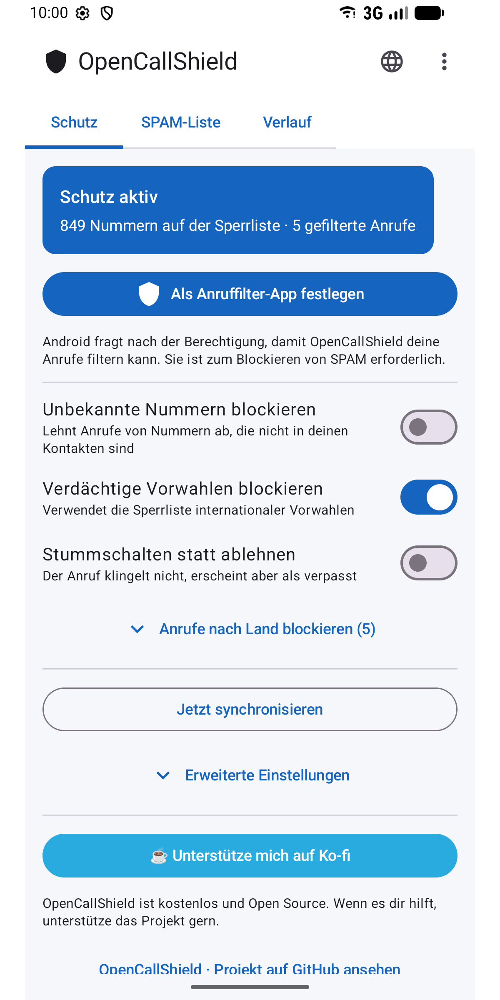
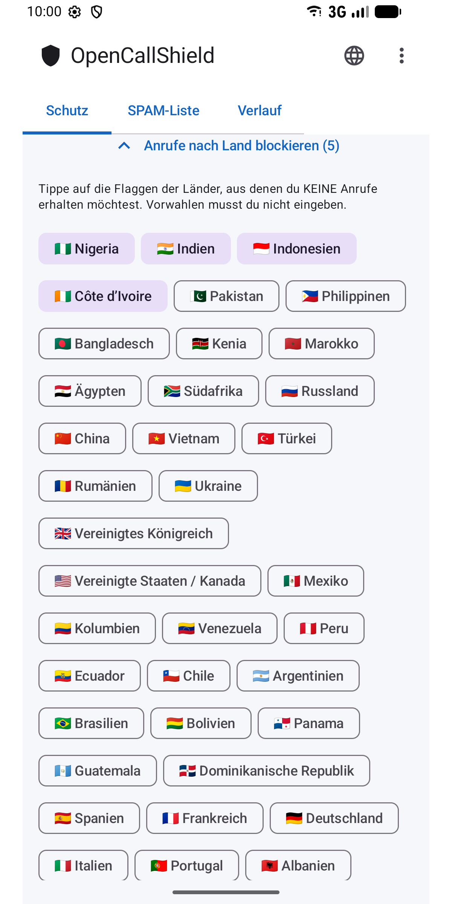
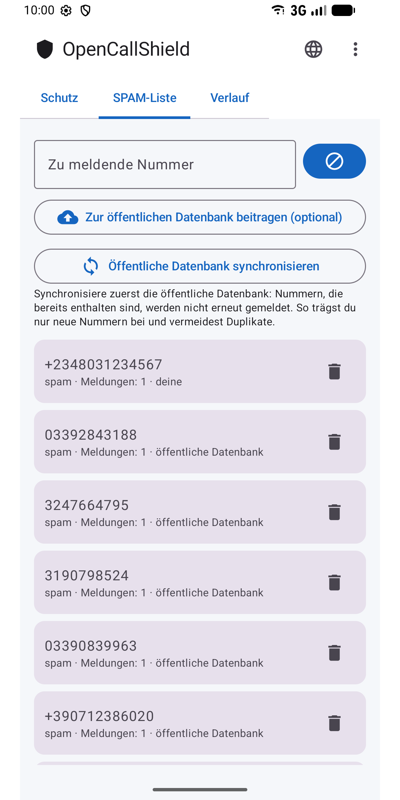
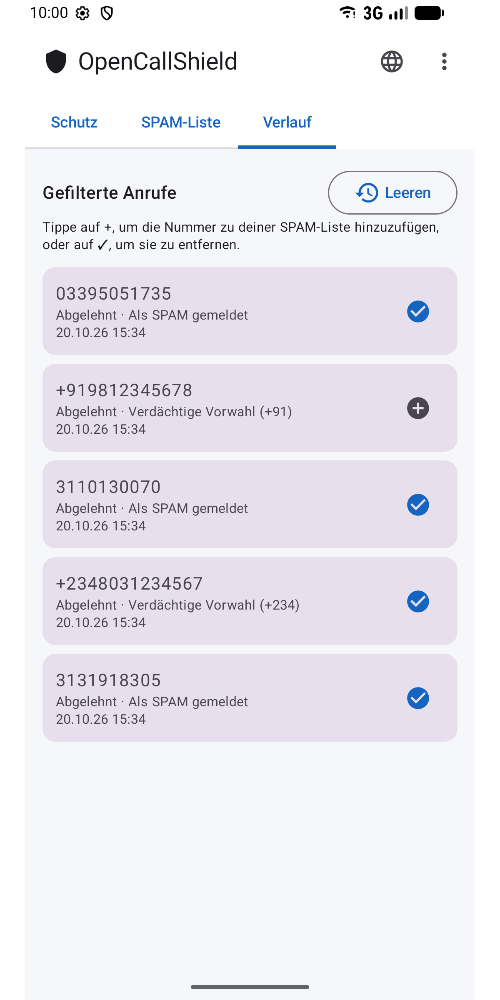
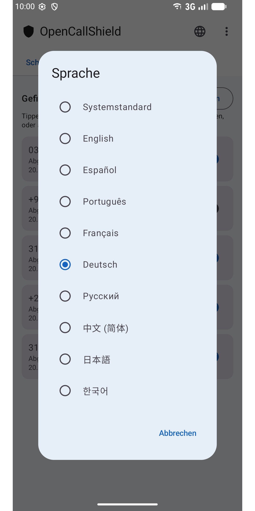

#  OpenCallShield

[English](../../README.md) · [Español](README.es.md) · [Português](README.pt.md) · [Français](README.fr.md) · **Deutsch** · [Русский](README.ru.md) · [中文](README.zh.md) · [日本語](README.ja.md) · [한국어](README.ko.md)

[](../../LICENSE)

Open-Source-Android-App (MIT), die **SPAM-Anrufe blockiert** – über `CallScreeningService` (Android 10+), mit lokaler Room-Datenbank, Regel-Engine zur Erkennung und Synchronisierung mit einer öffentlichen Gemeinschaftsliste auf GitHub.

Eine dezentrale, datenschutzfreundliche Alternative zu Truecaller.

## ⬇️ Herunterladen

<a href="https://play.google.com/store/apps/details?id=com.jhonsu01.opencallshield"></a>

- **Google Play:** https://play.google.com/store/apps/details?id=com.jhonsu01.opencallshield
- **APK:** lade die `.apk` unter [**Releases**](https://github.com/jhonsu01/OpenCallShield/releases) herunter.

## 📱 Screenshots

<p>
  
  
  
  
  
</p>

## ✨ Funktionen

- **Automatisches Blockieren** über `CallScreeningService` (ablehnen oder stummschalten).
- **Regel-Engine:** bekannter Kontakt → zulassen; gemeldete Nummer → blockieren; Vorwahl auf der Sperrliste → blockieren; Nummer nicht in den Kontakten → optional.
- **Blockieren nach Land** per Tipp auf die Flagge (keine Vorwahlen eintippen).
- **Lokale Room-Datenbank** mit gemeldeten Nummern.
- **Synchronisierung** mit einem öffentlichen JSON auf GitHub (täglich per WorkManager + manuell).
- **Meldungen** und Verlauf gefilterter Anrufe (Nummern mit einem Tipp hinzufügen oder entfernen).
- **9 Sprachen:** English, Español, Português, Français, Deutsch, Русский, 中文, 日本語, 한국어 – Auswahl über das 🌐-Symbol in der App oder in den App-Spracheinstellungen von Android.

## 🏗️ Stack

Kotlin · Jetpack Compose (Material 3) · Room · WorkManager · AppCompat · MVVM · `CallScreeningService` · targetSdk 36 (Android 16)

## 📦 Bauen

```bash
./gradlew assembleDebug
./gradlew assembleRelease
./gradlew bundleRelease
```

Benötigt JDK 17 und das Android SDK (compileSdk 36). Die Ergebnisse liegen in `app/build/outputs/`.

## 📲 Verwendung

1. Installiere die App.
2. Erteile die Kontaktberechtigung (damit deine Kontakte nie blockiert werden).
3. Tippe auf **„Als Anruffilter-App festlegen“** und bestätige die Rolle in Android.
4. Passe die Regeln an, wähle Länder zum Blockieren und/oder synchronisiere die Gemeinschaftsliste.

## 🌐 Gemeinschaftsliste

Die App synchronisiert aus [`spam_numbers.json`](../../spam_numbers.json) in diesem Repository. Die URL lässt sich in den *Erweiterten Einstellungen* ändern, sodass jeder eine eigene Liste betreiben kann ([Anleitung, auf Spanisch](../CREAR_BASE_COLABORATIVA.md)).

```
https://raw.githubusercontent.com/jhonsu01/OpenCallShield/main/spam_numbers.json
```

## 🔑 Aus der App beitragen (optional)

Unter **⋮ → Mitwirken** kannst du dich mit GitHub anmelden (OAuth-Gerätecode oder persönliches Token mit dem Bereich `public_repo`) und dann in der **SPAM-Liste** auf **„Zur öffentlichen Datenbank beitragen“** tippen: Die App öffnet ein **Issue** mit deinen Nummern als JSON, bereit zur Übernahme in `spam_numbers.json`. Das Token wird **verschlüsselt** auf dem Gerät gespeichert. Die Anmeldung ist optional: Die App funktioniert vollständig ohne Konto.

## 🔓 Lizenz

MIT — [LICENSE](../../LICENSE) · [PRIVACY.md](../../PRIVACY.md)

## ❤️ Projekt unterstützen

OpenCallShield ist **kostenlos und Open Source**. Wenn dir die App hilft, kannst du die Entwicklung unterstützen:

[](https://ko-fi.com/V7V81LV7GX)
