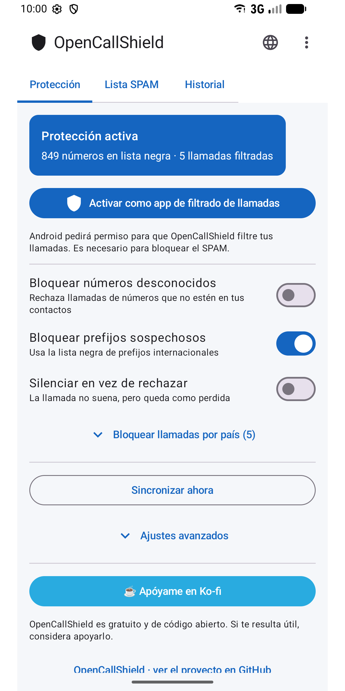
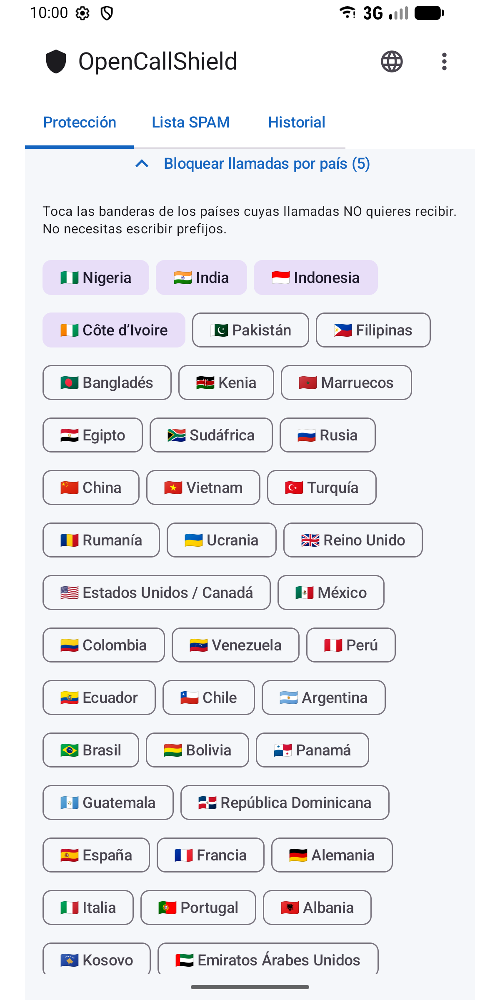
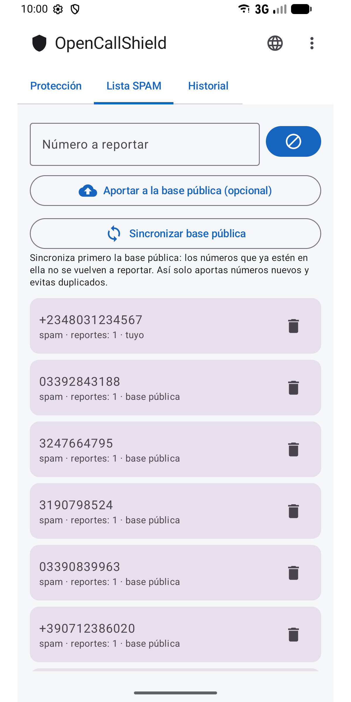
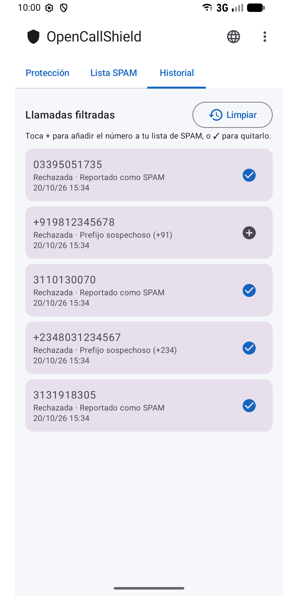
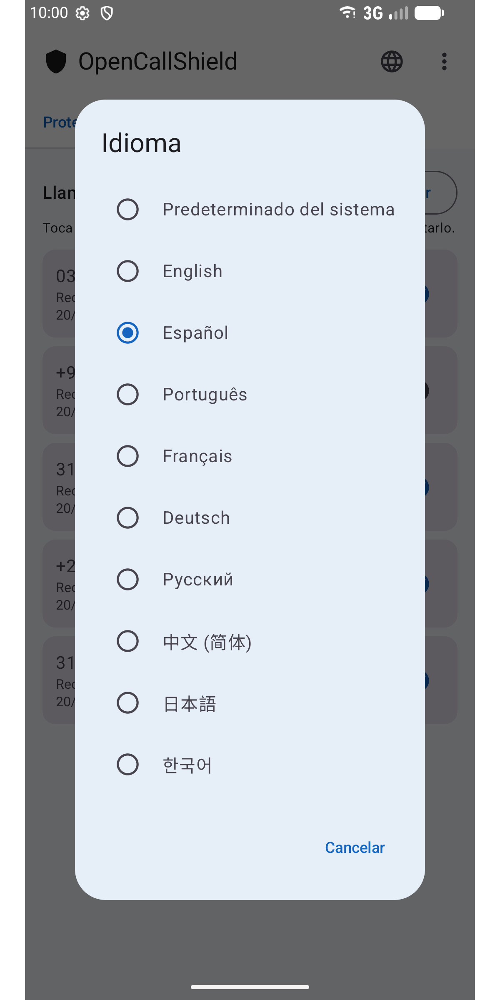

#  OpenCallShield

[English](../../README.md) · **Español** · [Português](README.pt.md) · [Français](README.fr.md) · [Deutsch](README.de.md) · [Русский](README.ru.md) · [中文](README.zh.md) · [日本語](README.ja.md) · [한국어](README.ko.md)

[](../../LICENSE)

App Android open source (MIT) para **bloquear llamadas SPAM** mediante `CallScreeningService` (Android 10+), con base de datos local Room, motor de reglas de detección y sincronización con una lista colaborativa pública en GitHub.

Alternativa privacidad-first y descentralizada a Truecaller.

## ⬇️ Descargar

<a href="https://play.google.com/store/apps/details?id=com.jhonsu01.opencallshield"></a>

- **Google Play:** https://play.google.com/store/apps/details?id=com.jhonsu01.opencallshield
- **APK:** descarga el `.apk` desde [**Releases**](https://github.com/jhonsu01/OpenCallShield/releases).

## 📱 Capturas

<p>
  
  
  
  
  
</p>

## ✨ Funciones

- **Bloqueo automático** vía `CallScreeningService` (rechazar o silenciar).
- **Motor de reglas:** contacto conocido → permitir; número reportado → bloquear; prefijo en lista negra → bloquear; número fuera de contactos → opcional.
- **Bloqueo por país** tocando la bandera (sin escribir prefijos).
- **Base local** Room con los números reportados.
- **Sincronización** con un JSON público en GitHub (diaria con WorkManager + manual).
- **Reportes** e historial de llamadas filtradas (añade o quita números con un toque).
- **9 idiomas:** English, Español, Português, Français, Deutsch, Русский, 中文, 日本語, 한국어 — elige desde el icono 🌐 de la app o desde los ajustes de idioma por app de Android.

## 🏗️ Stack

Kotlin · Jetpack Compose (Material 3) · Room · WorkManager · AppCompat · MVVM · `CallScreeningService` · targetSdk 36 (Android 16)

## 📦 Compilar

```bash
./gradlew assembleDebug
./gradlew assembleRelease
./gradlew bundleRelease
```

Requiere JDK 17 y Android SDK (compileSdk 36). Los resultados quedan en `app/build/outputs/`.

## 📲 Uso

1. Instala la app.
2. Concede el permiso de contactos (para no bloquear nunca a tus contactos).
3. Pulsa **"Activar como app de filtrado de llamadas"** y acepta el rol en Android.
4. Ajusta las reglas, elige países a bloquear y/o sincroniza la lista colaborativa.

## 🌐 Lista colaborativa

La app sincroniza desde [`spam_numbers.json`](../../spam_numbers.json) de este repositorio. La URL se puede cambiar en *Ajustes avanzados*, así cualquiera puede mantener su propia lista ([guía](../CREAR_BASE_COLABORATIVA.md)).

```
https://raw.githubusercontent.com/jhonsu01/OpenCallShield/main/spam_numbers.json
```

## 🔑 Aportar desde la app (opcional)

Desde **⋮ → Colaborar** puedes iniciar sesión con GitHub (código de dispositivo OAuth o token personal con permiso `public_repo`) y, en **Lista SPAM**, pulsar **"Aportar a la base pública"**: la app abre un **Issue** con tus números en JSON, listo para integrar en `spam_numbers.json`. El token se guarda **cifrado** en el dispositivo. Iniciar sesión es opcional: la app funciona completa sin cuenta.

## 🔓 Licencia

MIT — [LICENSE](../../LICENSE) · [PRIVACY.md](../../PRIVACY.md)

## ❤️ Apoyar el proyecto

OpenCallShield es **gratuito y open source**. Si te resulta útil, puedes apoyar su desarrollo:

[](https://ko-fi.com/V7V81LV7GX)
