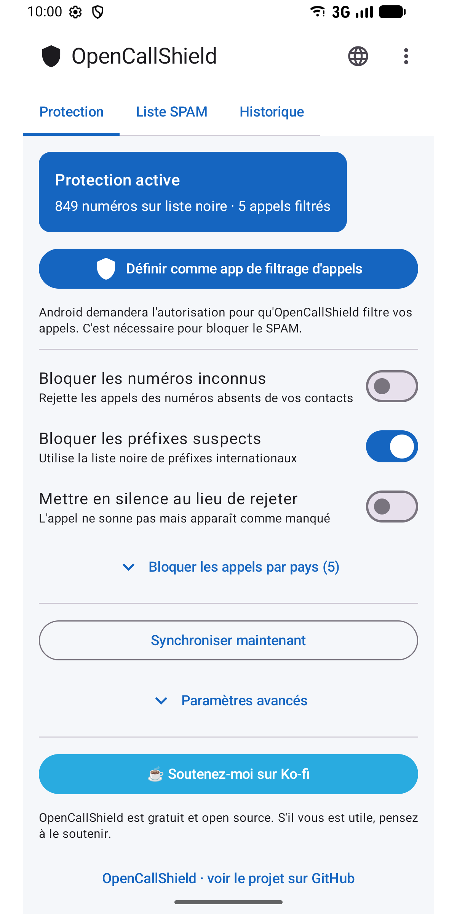
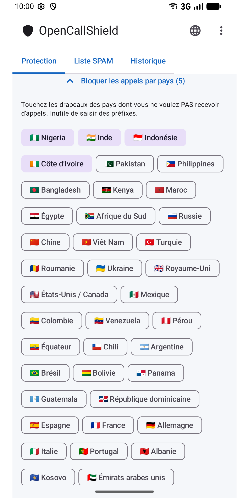
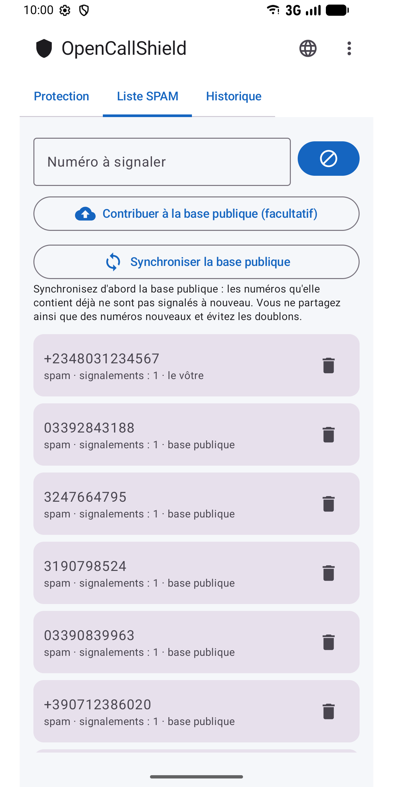
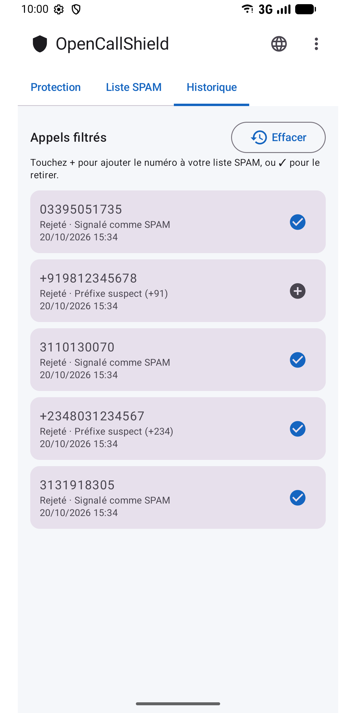
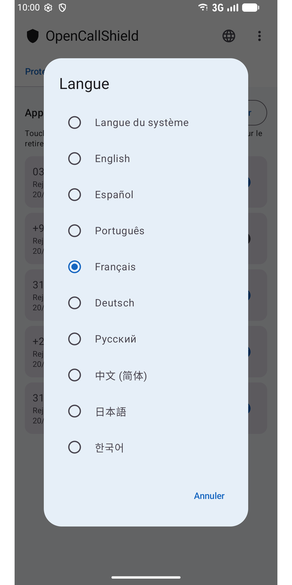

#  OpenCallShield

[English](../../README.md) · [Español](README.es.md) · [Português](README.pt.md) · **Français** · [Deutsch](README.de.md) · [Русский](README.ru.md) · [中文](README.zh.md) · [日本語](README.ja.md) · [한국어](README.ko.md)

[](../../LICENSE)

Application Android libre (MIT) qui **bloque les appels SPAM** grâce à `CallScreeningService` (Android 10+), avec une base locale Room, un moteur de règles de détection et une synchronisation avec une liste collaborative publique sur GitHub.

Une alternative décentralisée à Truecaller, respectueuse de la vie privée.

## ⬇️ Télécharger

<a href="https://play.google.com/store/apps/details?id=com.jhonsu01.opencallshield"></a>

- **Google Play:** https://play.google.com/store/apps/details?id=com.jhonsu01.opencallshield
- **APK:** téléchargez le `.apk` depuis [**Releases**](https://github.com/jhonsu01/OpenCallShield/releases).

## 📱 Captures d'écran

<p>
  
  
  
  
  
</p>

## ✨ Fonctionnalités

- **Blocage automatique** via `CallScreeningService` (rejeter ou mettre en silence).
- **Moteur de règles :** contact connu → autoriser ; numéro signalé → bloquer ; préfixe sur liste noire → bloquer ; numéro hors contacts → facultatif.
- **Blocage par pays** en touchant le drapeau (aucun préfixe à saisir).
- **Base locale** Room des numéros signalés.
- **Synchronisation** avec un JSON public sur GitHub (quotidienne via WorkManager + manuelle).
- **Signalements** et historique des appels filtrés (ajoutez ou retirez des numéros d'un toucher).
- **9 langues :** English, Español, Português, Français, Deutsch, Русский, 中文, 日本語, 한국어 — à choisir via l'icône 🌐 de l'application ou dans les paramètres de langue par application d'Android.

## 🏗️ Stack

Kotlin · Jetpack Compose (Material 3) · Room · WorkManager · AppCompat · MVVM · `CallScreeningService` · targetSdk 36 (Android 16)

## 📦 Compiler

```bash
./gradlew assembleDebug
./gradlew assembleRelease
./gradlew bundleRelease
```

Nécessite le JDK 17 et le SDK Android (compileSdk 36). Les fichiers produits se trouvent dans `app/build/outputs/`.

## 📲 Utilisation

1. Installez l'application.
2. Accordez l'autorisation d'accès aux contacts (pour ne jamais bloquer vos contacts).
3. Touchez **« Définir comme app de filtrage d'appels »** et acceptez le rôle dans Android.
4. Réglez les règles, choisissez les pays à bloquer et/ou synchronisez la liste collaborative.

## 🌐 Liste collaborative

L'application se synchronise depuis [`spam_numbers.json`](../../spam_numbers.json) de ce dépôt. L'URL peut être modifiée dans les *Paramètres avancés* : chacun peut donc tenir sa propre liste ([guide, en espagnol](../CREAR_BASE_COLABORATIVA.md)).

```
https://raw.githubusercontent.com/jhonsu01/OpenCallShield/main/spam_numbers.json
```

## 🔑 Contribuer depuis l'application (facultatif)

Depuis **⋮ → Contribuer**, connectez-vous avec GitHub (code d'appareil OAuth ou jeton personnel avec la portée `public_repo`) puis, dans **Liste SPAM**, touchez **« Contribuer à la base publique »** : l'application ouvre une **Issue** avec vos numéros en JSON, prête à être intégrée à `spam_numbers.json`. Le jeton est stocké **chiffré** sur l'appareil. La connexion est facultative : l'application fonctionne entièrement sans compte.

## 🔓 Licence

MIT — [LICENSE](../../LICENSE) · [PRIVACY.md](../../PRIVACY.md)

## ❤️ Soutenir le projet

OpenCallShield est **gratuit et open source**. S'il vous est utile, vous pouvez soutenir son développement :

[](https://ko-fi.com/V7V81LV7GX)
