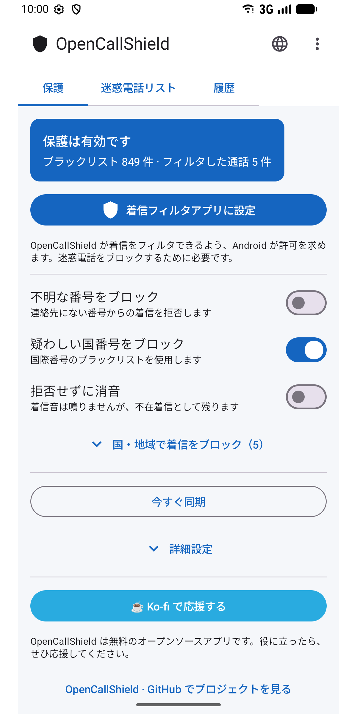
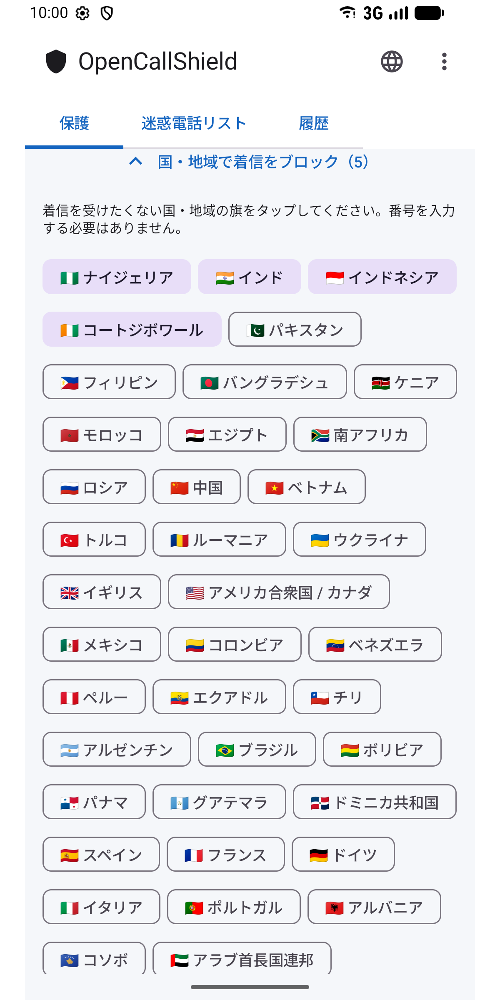
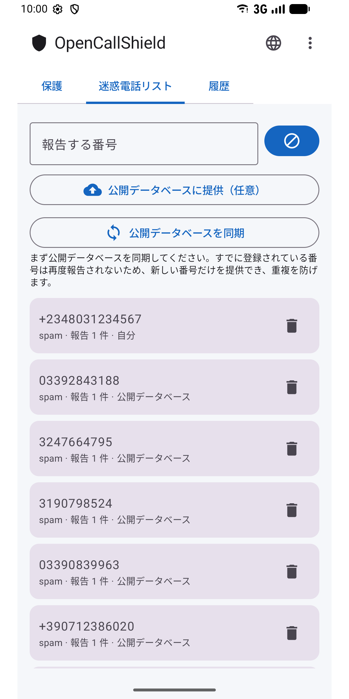
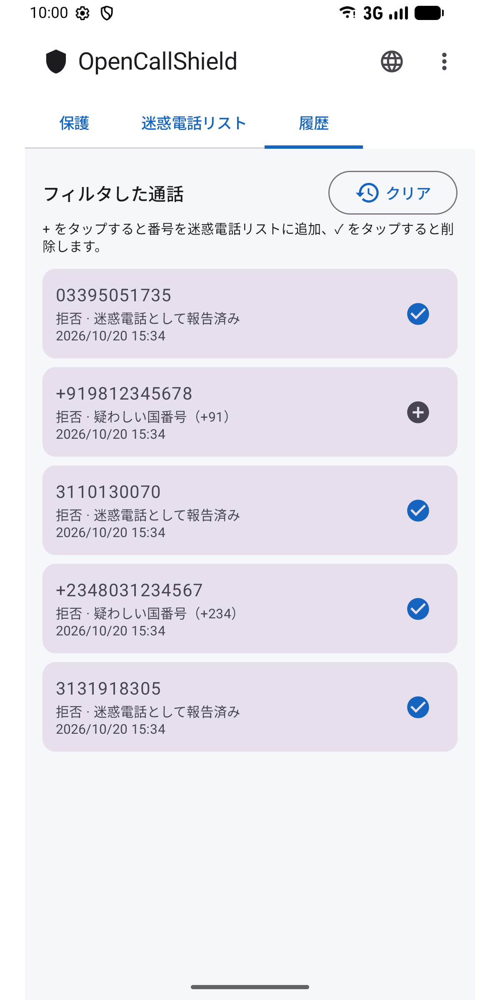
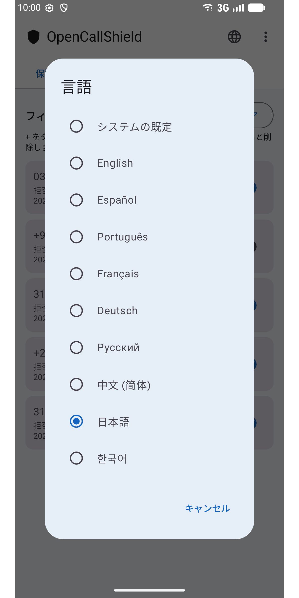

#  OpenCallShield

[English](../../README.md) · [Español](README.es.md) · [Português](README.pt.md) · [Français](README.fr.md) · [Deutsch](README.de.md) · [Русский](README.ru.md) · [中文](README.zh.md) · **日本語** · [한국어](README.ko.md)

[](../../LICENSE)

`CallScreeningService`（Android 10 以降）で**迷惑電話をブロック**するオープンソース（MIT）の Android アプリです。ローカルの Room データベース、検出ルールエンジン、GitHub 上の公開共有リストとの同期を備えています。

プライバシーを重視した、分散型の Truecaller 代替アプリです。

## ⬇️ ダウンロード

<a href="https://play.google.com/store/apps/details?id=com.jhonsu01.opencallshield"></a>

- **Google Play:** https://play.google.com/store/apps/details?id=com.jhonsu01.opencallshield
- **APK:** [**Releases**](https://github.com/jhonsu01/OpenCallShield/releases) から `.apk` をダウンロードできます。

## 📱 スクリーンショット

<p>
  
  
  
  
  
</p>

## ✨ 機能

- `CallScreeningService` による**自動ブロック**（拒否または消音）。
- **ルールエンジン：**既知の連絡先 → 許可、報告済みの番号 → ブロック、ブラックリストの国番号 → ブロック、連絡先にない番号 → 任意。
- 国旗をタップして**国・地域ごとにブロック**（番号の入力は不要）。
- 報告した番号を保存する**ローカル Room データベース**。
- GitHub 上の公開 JSON と**同期**（WorkManager で毎日 + 手動）。
- **報告**とフィルタした通話の履歴（ワンタップで番号を追加・削除）。
- **9 言語：**English、Español、Português、Français、Deutsch、Русский、中文、日本語、한국어 — アプリの 🌐 アイコン、または Android のアプリ別言語設定から選べます。

## 🏗️ Stack

Kotlin · Jetpack Compose (Material 3) · Room · WorkManager · AppCompat · MVVM · `CallScreeningService` · targetSdk 36 (Android 16)

## 📦 ビルド

```bash
./gradlew assembleDebug
./gradlew assembleRelease
./gradlew bundleRelease
```

JDK 17 と Android SDK（compileSdk 36）が必要です。成果物は `app/build/outputs/` にあります。

## 📲 使い方

1. アプリをインストールします。
2. 連絡先へのアクセスを許可します（連絡先を決してブロックしないため）。
3. **「着信フィルタアプリに設定」**をタップし、Android でロールを許可します。
4. ルールを調整し、ブロックする国・地域を選び、共有リストを同期します。

## 🌐 共有リスト

アプリはこのリポジトリの [`spam_numbers.json`](../../spam_numbers.json) から同期します。URL は*詳細設定*で変更できるため、誰でも独自のリストを運用できます（[ガイド・スペイン語](../CREAR_BASE_COLABORATIVA.md)）。

```
https://raw.githubusercontent.com/jhonsu01/OpenCallShield/main/spam_numbers.json
```

## 🔑 アプリから貢献（任意）

**⋮ → 貢献する** から GitHub でログインし（OAuth デバイスコード、または `public_repo` スコープの個人トークン）、**迷惑電話リスト**で**「公開データベースに提供」**をタップすると、番号を JSON にした **Issue** がこのリポジトリに作成され、そのまま `spam_numbers.json` に取り込めます。トークンは端末内に**暗号化**して保存されます。ログインは任意で、アカウントなしでもすべての機能を使えます。

## 🔓 ライセンス

MIT — [LICENSE](../../LICENSE) · [PRIVACY.md](../../PRIVACY.md)

## ❤️ プロジェクトを応援

OpenCallShield は**無料のオープンソース**です。役に立ったら、開発を応援してください：

[](https://ko-fi.com/V7V81LV7GX)
