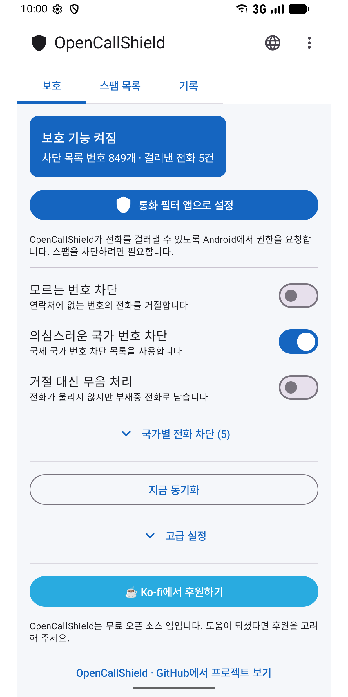
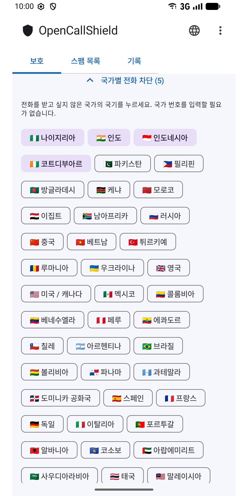
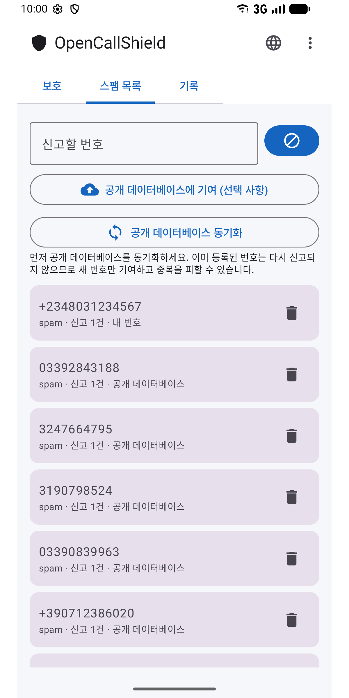
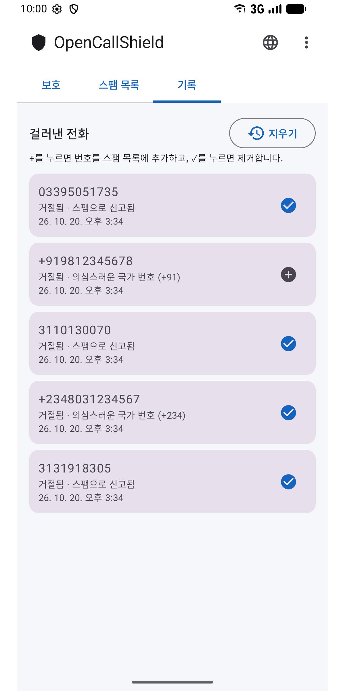
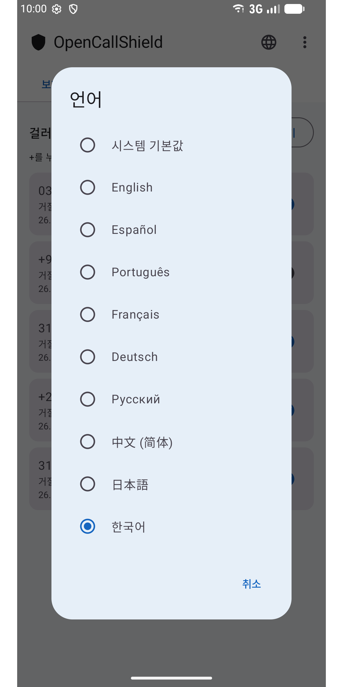

#  OpenCallShield

[English](../../README.md) · [Español](README.es.md) · [Português](README.pt.md) · [Français](README.fr.md) · [Deutsch](README.de.md) · [Русский](README.ru.md) · [中文](README.zh.md) · [日本語](README.ja.md) · **한국어**

[](../../LICENSE)

`CallScreeningService`(Android 10+)로 **스팸 전화를 차단**하는 오픈 소스(MIT) Android 앱입니다. 로컬 Room 데이터베이스, 감지 규칙 엔진, GitHub의 공개 공유 목록 동기화를 제공합니다.

개인정보 보호를 우선하는 분산형 Truecaller 대안입니다.

## ⬇️ 다운로드

<a href="https://play.google.com/store/apps/details?id=com.jhonsu01.opencallshield"></a>

- **Google Play:** https://play.google.com/store/apps/details?id=com.jhonsu01.opencallshield
- **APK:** [**Releases**](https://github.com/jhonsu01/OpenCallShield/releases)에서 `.apk`를 다운로드하세요.

## 📱 스크린샷

<p>
  
  
  
  
  
</p>

## ✨ 기능

- `CallScreeningService`를 통한 **자동 차단**(거절 또는 무음).
- **규칙 엔진:** 알려진 연락처 → 허용, 신고된 번호 → 차단, 차단 목록의 국가 번호 → 차단, 연락처에 없는 번호 → 선택 사항.
- 국기를 탭하여 **국가별 차단**(국가 번호 입력 불필요).
- 신고된 번호를 저장하는 **로컬 Room 데이터베이스**.
- GitHub의 공개 JSON과 **동기화**(WorkManager로 매일 + 수동).
- **신고** 및 걸러낸 전화 기록(탭 한 번으로 번호 추가·제거).
- **9개 언어:** English, Español, Português, Français, Deutsch, Русский, 中文, 日本語, 한국어 — 앱의 🌐 아이콘 또는 Android의 앱별 언어 설정에서 선택하세요.

## 🏗️ Stack

Kotlin · Jetpack Compose (Material 3) · Room · WorkManager · AppCompat · MVVM · `CallScreeningService` · targetSdk 36 (Android 16)

## 📦 빌드

```bash
./gradlew assembleDebug
./gradlew assembleRelease
./gradlew bundleRelease
```

JDK 17과 Android SDK(compileSdk 36)가 필요합니다. 결과물은 `app/build/outputs/`에 있습니다.

## 📲 사용 방법

1. 앱을 설치합니다.
2. 연락처 권한을 허용합니다(연락처가 절대 차단되지 않도록).
3. **"통화 필터 앱으로 설정"**을 탭하고 Android에서 역할을 허용합니다.
4. 규칙을 조정하고, 차단할 국가를 선택하고, 공유 목록을 동기화합니다.

## 🌐 공유 목록

앱은 이 저장소의 [`spam_numbers.json`](../../spam_numbers.json)에서 동기화합니다. *고급 설정*에서 URL을 바꿀 수 있으므로 누구나 자신만의 목록을 운영할 수 있습니다([가이드, 스페인어](../CREAR_BASE_COLABORATIVA.md)).

```
https://raw.githubusercontent.com/jhonsu01/OpenCallShield/main/spam_numbers.json
```

## 🔑 앱에서 기여하기(선택 사항)

**⋮ → 기여하기**에서 GitHub로 로그인(OAuth 기기 코드 또는 `public_repo` 범위의 개인 토큰)한 뒤 **스팸 목록**에서 **"공개 데이터베이스에 기여"**를 탭하면, 앱이 번호를 JSON으로 담은 **Issue**를 만들어 `spam_numbers.json`에 바로 반영할 수 있습니다. 토큰은 기기에 **암호화**되어 저장됩니다. 로그인은 선택 사항이며 계정 없이도 모든 기능을 사용할 수 있습니다.

## 🔓 라이선스

MIT — [LICENSE](../../LICENSE) · [PRIVACY.md](../../PRIVACY.md)

## ❤️ 프로젝트 후원

OpenCallShield는 **무료 오픈 소스**입니다. 도움이 되셨다면 개발을 후원해 주세요:

[](https://ko-fi.com/V7V81LV7GX)
