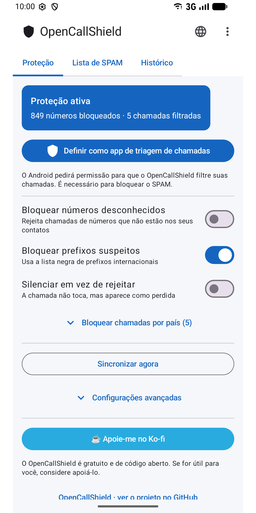
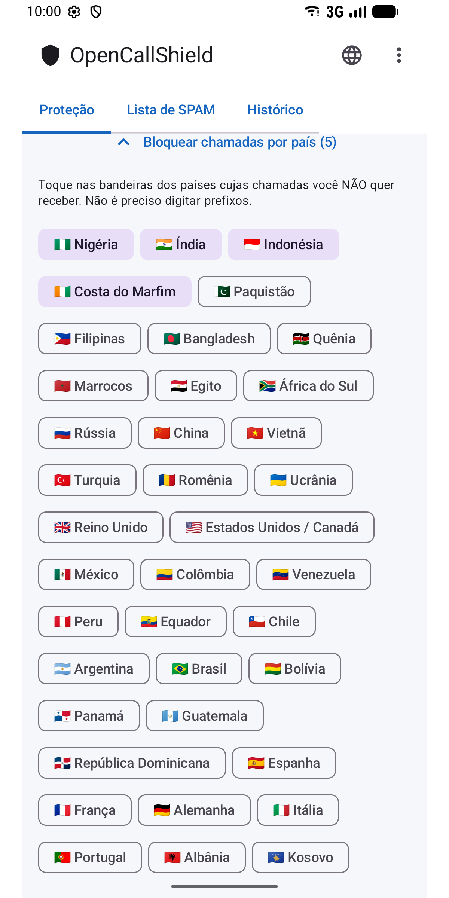
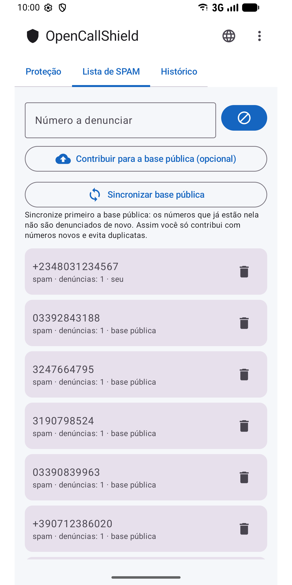
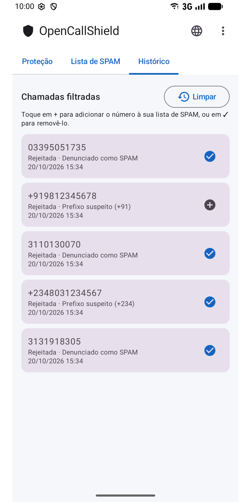
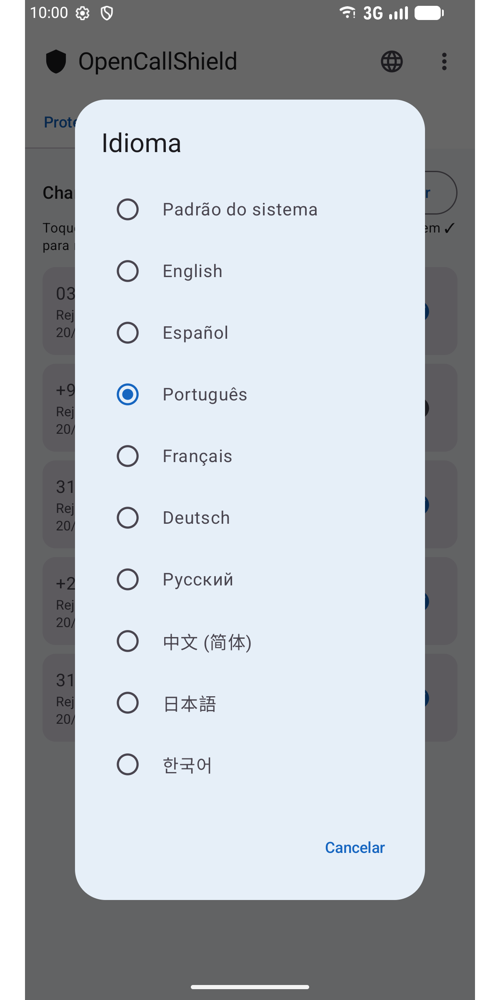

#  OpenCallShield

[English](../../README.md) · [Español](README.es.md) · **Português** · [Français](README.fr.md) · [Deutsch](README.de.md) · [Русский](README.ru.md) · [中文](README.zh.md) · [日本語](README.ja.md) · [한국어](README.ko.md)

[](../../LICENSE)

App Android open source (MIT) para **bloquear chamadas de SPAM** com `CallScreeningService` (Android 10+), com banco de dados local Room, motor de regras de detecção e sincronização com uma lista colaborativa pública no GitHub.

Uma alternativa descentralizada ao Truecaller, com a privacidade em primeiro lugar.

## ⬇️ Baixar

<a href="https://play.google.com/store/apps/details?id=com.jhonsu01.opencallshield"></a>

- **Google Play:** https://play.google.com/store/apps/details?id=com.jhonsu01.opencallshield
- **APK:** baixe o `.apk` em [**Releases**](https://github.com/jhonsu01/OpenCallShield/releases).

## 📱 Capturas de tela

<p>
  
  
  
  
  
</p>

## ✨ Recursos

- **Bloqueio automático** via `CallScreeningService` (rejeitar ou silenciar).
- **Motor de regras:** contato conhecido → permitir; número denunciado → bloquear; prefixo na lista negra → bloquear; número fora dos contatos → opcional.
- **Bloqueio por país** tocando na bandeira (sem digitar prefixos).
- **Banco local** Room com os números denunciados.
- **Sincronização** com um JSON público no GitHub (diária via WorkManager + manual).
- **Denúncias** e histórico de chamadas filtradas (adicione ou remova números com um toque).
- **9 idiomas:** English, Español, Português, Français, Deutsch, Русский, 中文, 日本語, 한국어 — escolha pelo ícone 🌐 do app ou nas configurações de idioma por app do Android.

## 🏗️ Stack

Kotlin · Jetpack Compose (Material 3) · Room · WorkManager · AppCompat · MVVM · `CallScreeningService` · targetSdk 36 (Android 16)

## 📦 Compilar

```bash
./gradlew assembleDebug
./gradlew assembleRelease
./gradlew bundleRelease
```

Requer JDK 17 e Android SDK (compileSdk 36). Os resultados ficam em `app/build/outputs/`.

## 📲 Uso

1. Instale o app.
2. Conceda a permissão de contatos (para nunca bloquear seus contatos).
3. Toque em **"Definir como app de triagem de chamadas"** e aceite a função no Android.
4. Ajuste as regras, escolha países para bloquear e/ou sincronize a lista colaborativa.

## 🌐 Lista colaborativa

O app sincroniza a partir de [`spam_numbers.json`](../../spam_numbers.json) deste repositório. A URL pode ser alterada em *Configurações avançadas*, então qualquer pessoa pode manter sua própria lista ([guia, em espanhol](../CREAR_BASE_COLABORATIVA.md)).

```
https://raw.githubusercontent.com/jhonsu01/OpenCallShield/main/spam_numbers.json
```

## 🔑 Contribuir pelo app (opcional)

Em **⋮ → Colaborar** você pode entrar com o GitHub (código de dispositivo OAuth ou token pessoal com escopo `public_repo`) e, em **Lista de SPAM**, tocar em **"Contribuir para a base pública"**: o app abre uma **Issue** com seus números em JSON, pronta para ser integrada ao `spam_numbers.json`. O token fica **criptografado** no aparelho. Entrar é opcional: o app funciona completamente sem conta.

## 🔓 Licença

MIT — [LICENSE](../../LICENSE) · [PRIVACY.md](../../PRIVACY.md)

## ❤️ Apoie o projeto

O OpenCallShield é **gratuito e open source**. Se for útil para você, apoie o desenvolvimento:

[](https://ko-fi.com/V7V81LV7GX)
