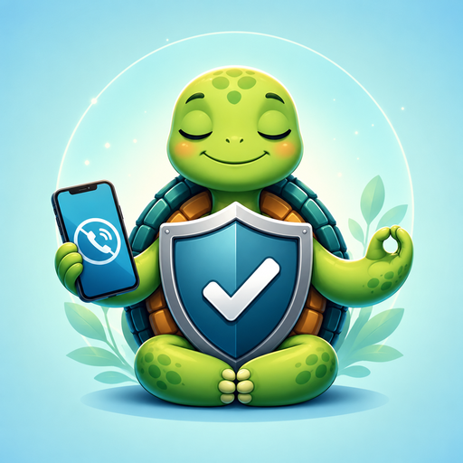
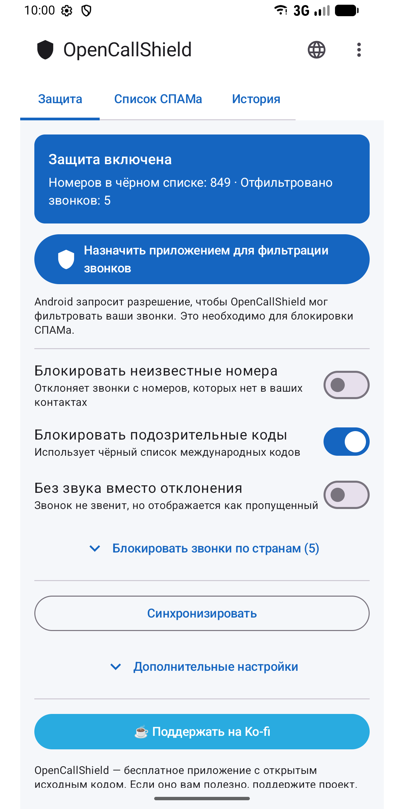
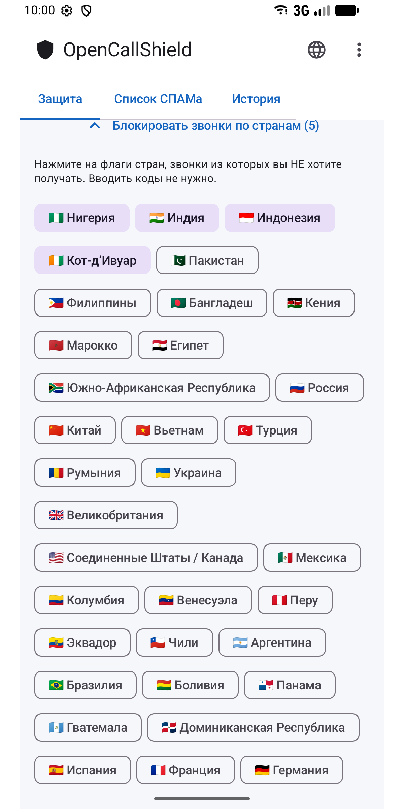
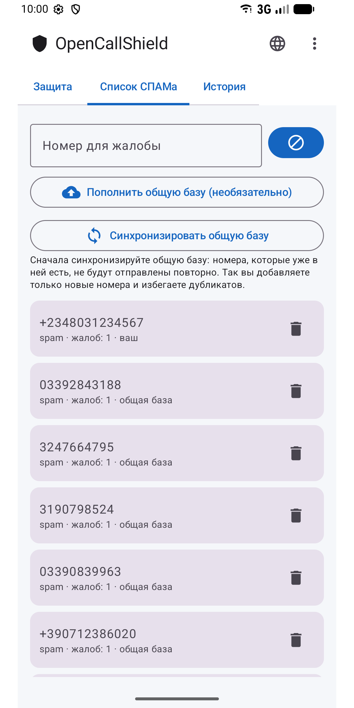
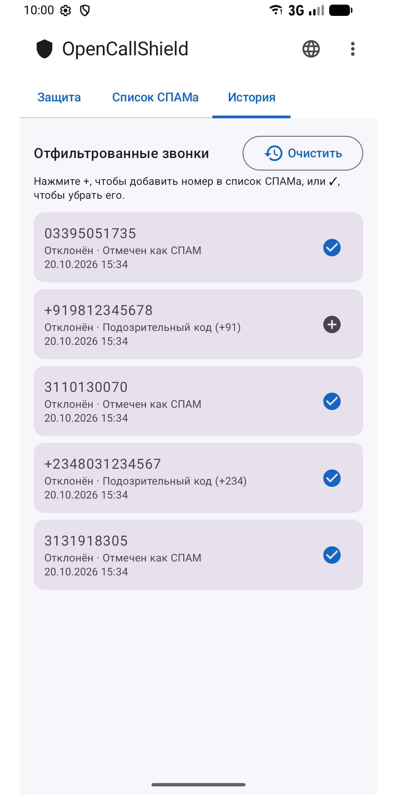
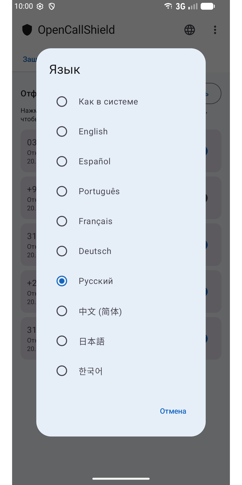

#  OpenCallShield

[English](../../README.md) · [Español](README.es.md) · [Português](README.pt.md) · [Français](README.fr.md) · [Deutsch](README.de.md) · **Русский** · [中文](README.zh.md) · [日本語](README.ja.md) · [한국어](README.ko.md)

[](../../LICENSE)

Android-приложение с открытым кодом (MIT), которое **блокирует спам-звонки** через `CallScreeningService` (Android 10+). Локальная база Room, движок правил обнаружения и синхронизация с общим публичным списком на GitHub.

Децентрализованная альтернатива Truecaller с приоритетом конфиденциальности.

## ⬇️ Скачать

<a href="https://play.google.com/store/apps/details?id=com.jhonsu01.opencallshield"></a>

- **Google Play:** https://play.google.com/store/apps/details?id=com.jhonsu01.opencallshield
- **APK:** скачайте `.apk` в разделе [**Releases**](https://github.com/jhonsu01/OpenCallShield/releases).

## 📱 Скриншоты

<p>
  
  
  
  
  
</p>

## ✨ Возможности

- **Автоматическая блокировка** через `CallScreeningService` (отклонить или без звука).
- **Движок правил:** известный контакт → пропустить; номер в жалобах → блокировать; код в чёрном списке → блокировать; номер не из контактов → по желанию.
- **Блокировка по странам** нажатием на флаг (без ввода кодов).
- **Локальная база** Room с отмеченными номерами.
- **Синхронизация** с публичным JSON на GitHub (ежедневно через WorkManager + вручную).
- **Жалобы** и история отфильтрованных звонков (добавляйте и убирайте номера одним нажатием).
- **9 языков:** English, Español, Português, Français, Deutsch, Русский, 中文, 日本語, 한국어 — выбор через значок 🌐 в приложении или в настройках языка приложений Android.

## 🏗️ Stack

Kotlin · Jetpack Compose (Material 3) · Room · WorkManager · AppCompat · MVVM · `CallScreeningService` · targetSdk 36 (Android 16)

## 📦 Сборка

```bash
./gradlew assembleDebug
./gradlew assembleRelease
./gradlew bundleRelease
```

Нужны JDK 17 и Android SDK (compileSdk 36). Результаты — в `app/build/outputs/`.

## 📲 Использование

1. Установите приложение.
2. Разрешите доступ к контактам (чтобы контакты никогда не блокировались).
3. Нажмите **«Назначить приложением для фильтрации звонков»** и подтвердите роль в Android.
4. Настройте правила, выберите страны для блокировки и/или синхронизируйте общий список.

## 🌐 Общий список

Приложение синхронизируется из [`spam_numbers.json`](../../spam_numbers.json) этого репозитория. URL можно изменить в *Дополнительных настройках*, поэтому любой может вести собственный список ([руководство на испанском](../CREAR_BASE_COLABORATIVA.md)).

```
https://raw.githubusercontent.com/jhonsu01/OpenCallShield/main/spam_numbers.json
```

## 🔑 Вклад из приложения (необязательно)

В меню **⋮ → Участие** можно войти через GitHub (код устройства OAuth или личный токен с областью `public_repo`), а затем в **Списке СПАМа** нажать **«Пополнить общую базу»**: приложение создаст **Issue** с вашими номерами в JSON, готовыми для `spam_numbers.json`. Токен хранится на устройстве **в зашифрованном виде**. Вход необязателен: приложение полностью работает без аккаунта.

## 🔓 Лицензия

MIT — [LICENSE](../../LICENSE) · [PRIVACY.md](../../PRIVACY.md)

## ❤️ Поддержать проект

OpenCallShield **бесплатен и открыт**. Если приложение вам полезно, поддержите разработку:

[](https://ko-fi.com/V7V81LV7GX)
