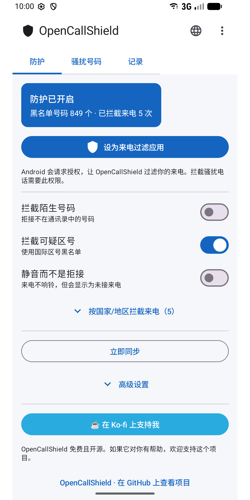
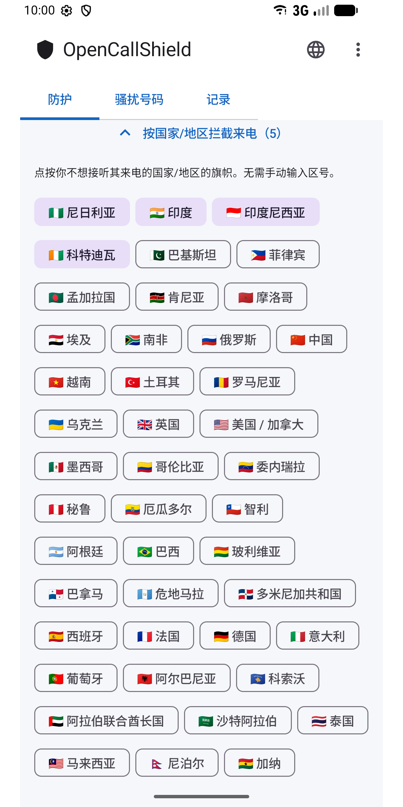
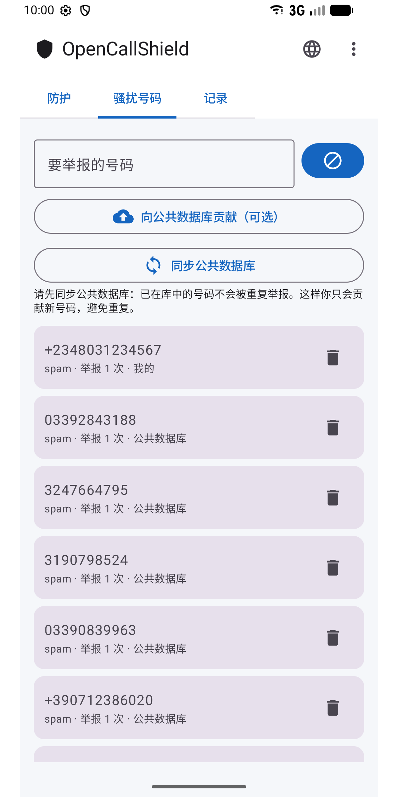
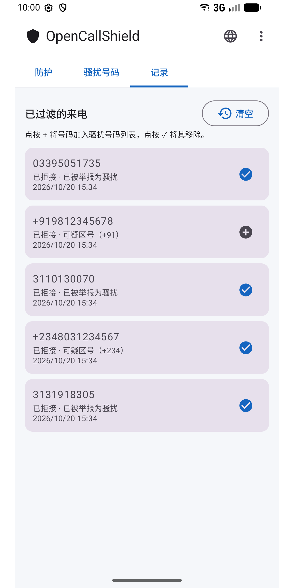
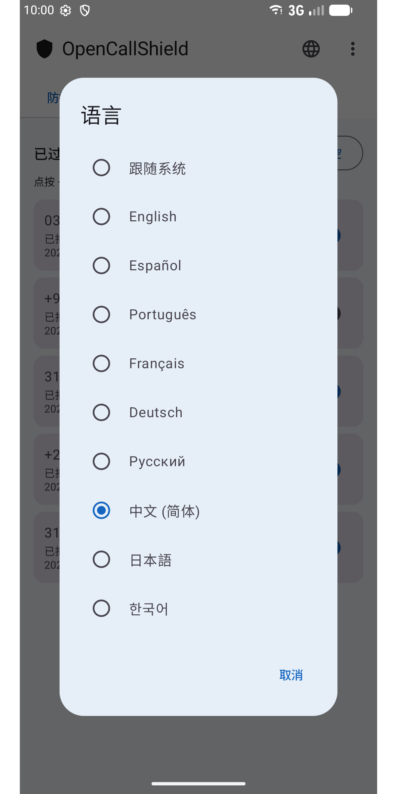

#  OpenCallShield

[English](../../README.md) · [Español](README.es.md) · [Português](README.pt.md) · [Français](README.fr.md) · [Deutsch](README.de.md) · [Русский](README.ru.md) · **中文** · [日本語](README.ja.md) · [한국어](README.ko.md)

[](../../LICENSE)

开源（MIT）Android 应用，通过 `CallScreeningService`（Android 10+）**拦截骚扰电话**，配备本地 Room 数据库、识别规则引擎，并与托管在 GitHub 上的公共共享名单同步。

注重隐私、去中心化的 Truecaller 替代方案。

## ⬇️ 下载

<a href="https://play.google.com/store/apps/details?id=com.jhonsu01.opencallshield"></a>

- **Google Play:** https://play.google.com/store/apps/details?id=com.jhonsu01.opencallshield
- **APK:** 在 [**Releases**](https://github.com/jhonsu01/OpenCallShield/releases) 下载 `.apk`。

## 📱 截图

<p>
  
  
  
  
  
</p>

## ✨ 功能

- 通过 `CallScreeningService` **自动拦截**（拒接或静音）。
- **规则引擎：**已知联系人 → 放行；被举报号码 → 拦截；黑名单区号 → 拦截；不在通讯录中的号码 → 可选。
- 点按国旗即可**按国家/地区拦截**（无需输入区号）。
- 保存举报号码的**本地 Room 数据库**。
- 与 GitHub 上的公共 JSON **同步**（WorkManager 每日同步 + 手动同步）。
- **举报**及已过滤来电记录（一键添加或移除号码）。
- **9 种语言：**English、Español、Português、Français、Deutsch、Русский、中文、日本語、한국어 —— 可在应用内的 🌐 图标或 Android 的应用语言设置中选择。

## 🏗️ Stack

Kotlin · Jetpack Compose (Material 3) · Room · WorkManager · AppCompat · MVVM · `CallScreeningService` · targetSdk 36 (Android 16)

## 📦 构建

```bash
./gradlew assembleDebug
./gradlew assembleRelease
./gradlew bundleRelease
```

需要 JDK 17 和 Android SDK（compileSdk 36）。产物位于 `app/build/outputs/`。

## 📲 使用方法

1. 安装应用。
2. 授予通讯录权限（确保永远不会拦截你的联系人）。
3. 点按**“设为来电过滤应用”**，并在 Android 中接受该角色。
4. 调整规则、选择要拦截的国家/地区，和/或同步共享名单。

## 🌐 共享名单

应用从本仓库的 [`spam_numbers.json`](../../spam_numbers.json) 同步。可在*高级设置*中更改 URL，任何人都可以维护自己的名单（[指南，西班牙语](../CREAR_BASE_COLABORATIVA.md)）。

```
https://raw.githubusercontent.com/jhonsu01/OpenCallShield/main/spam_numbers.json
```

## 🔑 从应用贡献（可选）

在 **⋮ → 参与贡献** 中使用 GitHub 登录（OAuth 设备代码，或具有 `public_repo` 权限的个人令牌），然后在**骚扰号码**中点按**“向公共数据库贡献”**：应用会创建一个包含你的号码（JSON 格式）的 **Issue**，可直接合并到 `spam_numbers.json`。令牌在设备上**加密**保存。登录是可选的：不登录也能使用全部功能。

## 🔓 许可证

MIT — [LICENSE](../../LICENSE) · [PRIVACY.md](../../PRIVACY.md)

## ❤️ 支持本项目

OpenCallShield **免费且开源**。如果它对你有帮助，欢迎支持开发：

[](https://ko-fi.com/V7V81LV7GX)
